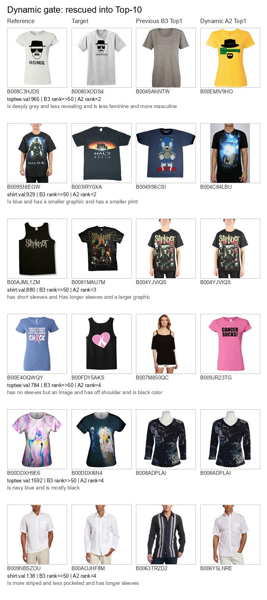
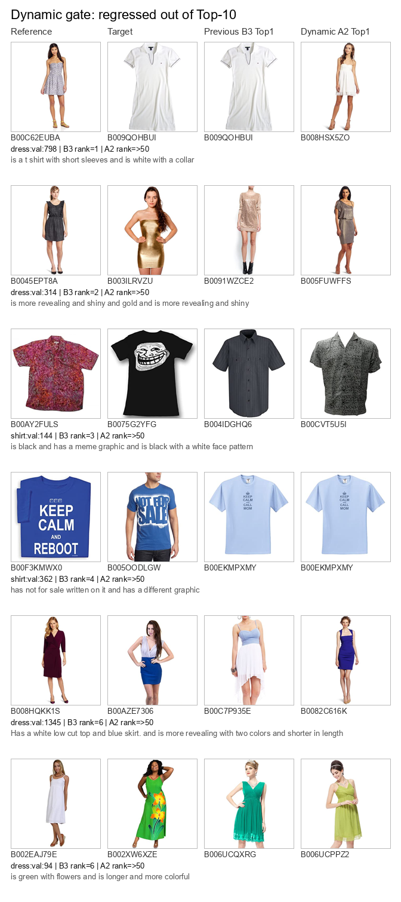

# FashionIQ 自适应融合实验报告

记录日期：2026 年 10 月 26 日

## 1 结论

本轮已完成 caption 编码消融、训练集权重选择、类别权重、查询级动态门控、验证集冻结评测、配对统计检验、两次复跑和案例可视化。

最终方案 `A2_train_tuned_dynamic` 使用“正序/反序拼接文本向量平均”，再根据显式同款意图与文本检索置信度选择图像权重。在 FashionIQ val 上取得类别平均 R@10 `24.17%`、R@50 `41.53%`。

相对旧 B3，R@10 提升 `0.95` 个百分点，查询级净增加 63 个 Top-10 命中；R@50 基本不变。更重要的是，本轮所有选择均只使用 train，参数冻结后才读取 val 结果，修复了旧 B3 在同一验证集调参与报告的偏差。

## 2 数据切分与防泄漏协议

| 项目 | Train | Validation |
|---|---:|---:|
| 图库 | 45,429 | 15,415 |
| 组合查询 | 18,000 | 6,016 |
| 用途 | caption/权重/阈值选择 | 冻结后一次性报告 |

模型、权重网格、置信度阈值、身份意图规则和门控分组均在 train 确定。val 目标没有参与参数选择。图像与文本仍使用同一个 OpenCLIP ViT-B/32 权重和精确 FAISS `IndexFlatIP`。

本次 val 已被用于正式报告；后续不得根据本报告的 val 结果继续调参。新的算法修改应在 train 内部交叉验证，或使用新的独立标注集。

## 3 Caption 编码消融

四种策略均在 train 的 0.0—1.0 权重网格上选择图像权重，然后冻结到 val；四者均选中图像权重 0.3。

| Caption 策略 | Train Mean R@10 | Val Mean R@10 | Val Mean R@50 |
|---|---:|---:|---:|
| 正序拼接 | 17.98% | 22.14% | 39.43% |
| 反序拼接 | 18.04% | 21.90% | 39.60% |
| 两句分别编码后平均 | 15.72% | 18.61% | 34.13% |
| 正反拼接向量平均 | **18.32%** | **22.37%** | **40.02%** |

结论：单独编码短句再平均明显损失上下文；正反顺序拼接后平均能减轻顺序敏感性，并在 train 上成为预先选择的方案。

## 4 自适应融合结果

| 方法 | 参数来源 | Mean R@10 | Mean R@50 |
|---|---|---:|---:|
| 旧 B3：正序拼接、图像 0.2 | val，同集调参锚点 | 23.12% | 41.55% |
| A0：正反拼接平均、全局 0.3 | train | 22.37% | 40.02% |
| A1：按类别选择权重 | train | 22.37% | 40.02% |
| A2：查询级动态门控 | train | **24.17%** | 41.53% |

按类别权重没有带来收益，因为 train 上 Dress、Shirt、Toptee 都选中 0.3。真正的增益来自查询级门控：

- Dress：显式同款意图权重 0.5，其余置信度组均为 0.3；
- Shirt：同款意图 0.9，低/中/高文本置信度分别为 0.4/0.3/0.2；
- Toptee：同款意图 0.7，低/中/高文本置信度分别为 0.3/0.3/0.2。

它符合可解释规律：文本检索越有把握，越少引入参考图；明确要求同款时，提高参考图权重。

## 5 配对统计与失败边界

A2 相对旧 B3：

| 指标 | 结果 |
|---|---:|
| Top-10 救回 / 退化 | 198 / 135 |
| Top-10 净增命中 | 63 |
| R@10 查询加权差值 | +1.05 个百分点 |
| R@10 McNemar 双侧精确检验 | `p=0.000658` |
| R@10 分类别配对 bootstrap 95% CI | `[+0.46, +1.63]` 个百分点 |
| Top-50 救回 / 退化 | 186 / 187 |
| R@50 McNemar 双侧精确检验 | `p=1.0` |

R@10 改善有一致的配对证据；R@50 没有改善，不能宣称全指标全面提升。动态方案仍有 3,520 条目标落在 Top-50 之外。

按类别的 Top-10 救回/退化为 Dress 73/62、Shirt 68/34、Toptee 57/39。当前门控对 Shirt 和 Toptee 更有效，Dress 基本持平。

## 6 案例审查

- `artifacts/figures/fashioniq_dynamic_rescued.png`：6 个从 Top-10 外救回的样例。
- `artifacts/figures/fashioniq_dynamic_regressed.png`：6 个从 Top-10 内退化的样例。

人工审查显示，动态门控能在颜色、版型和图案组合描述上救回一部分目标；退化案例通常是旧 B3 已依赖更强文本匹配命中的细粒度描述。下一版若继续优化，应采用连续置信度校准或轻量学习门控，而不是继续手工增加 val 规则。

## 7 验收与复现

- 4 个方法 × 6,016 查询，共 24,064 条排名记录；
- 无参考图泄漏、无重复 ID、每条均有 Top-50；
- 保存指标可从排名精确重算；
- 两次运行的参数、指标和逐字节排名完全一致；
- 排名 SHA256：`c2d976cbab143d3b9dd84ccd6b8443e04dc93fb5d3e536114efc49b1a099fb28`；
- 首轮含 train 图像/文本编码 591.149 秒，缓存复跑 91.935 秒；
- 测试由 11 项增加到 14 项并全部通过。

## 8 阶段交付与下一步

| 子阶段 | 交付目标 | 测试目标 | 状态 |
|---|---|---|---|
| Caption 消融 | 四种编码策略、train 选择、val 报告 | 切分隔离、缓存一致 | 完成 |
| 权重选择 | 全局与类别权重由 train 决定 | val 不参与选择 | 完成 |
| 动态门控 | 可解释规则与冻结参数 | 排名验收、配对统计 | 完成 |
| 失败分析 | 救回/退化计数和图像对照页 | 人工可审查 | 完成 |
| CIRR 对拍 | 同协议全局与 subset Recall | 官方原图完整、指标可重算 | 等待授权 |

FashionIQ 当前应冻结 A2，不再利用 val 结果修改规则。等待 CIRR 期间，可以在 train 内部做交叉验证的轻量门控模型；若工作重心转向系统交付，则下一项应是第三阶段的在线会话 API、反馈状态机和回退测试。

## 9 产物

| 产物 | 路径 |
|---|---|
| 完整 summary | `D:\image_data\derived\rankings\fashioniq_val_fashioniq-adaptive-train-val-v1\summary.json` |
| 逐查询排名 | 同目录 `rankings.jsonl` |
| 独立验收 | `artifacts/metrics/fashioniq_adaptive_verification.json` |
| 配对分析 | `artifacts/metrics/fashioniq_adaptive_analysis.json` |
| 精简交付摘要 | `artifacts/metrics/fashioniq_adaptive_delivery.json` |
| 救回/退化图 | `artifacts/figures/fashioniq_dynamic_*.png` |
