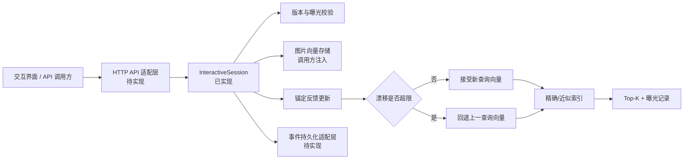
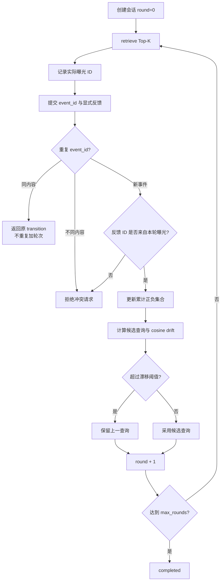

# 第三阶段多轮会话状态机交付

记录日期：2026 年 10 月 26 日

> 本文档记录会话核心里程碑；FastAPI/SQLite 与真实索引/页面的后续交付分别见 `docs/14_第三阶段API与SQLite交付_2026-10-26.md` 和 `docs/15_第三阶段真实索引与交互页面交付_2026-10-28.md`。图中的“待实现”保留为当时状态。

## 1 结论

第三阶段已从“未开始”推进到“核心状态机完成、接口与持久化待接入”。本轮实现不依赖 CIRR 原图，也没有继续使用 FashionIQ val 调参。

已交付 `InteractiveSession`：它管理初始查询、当前查询、轮次、曝光列表、累计正负反馈、版本信息、事件幂等、漂移保护和会话结束状态。合成两轮端到端烟雾测试通过，单元与契约测试总数由 14 项增加到 19 项。

## 2 当前架构

边界说明：状态机不保存密码、用户身份或原始图片；`session_id` 必须由上层去标识化。文本反馈在进入核心前编码为向量，核心的幂等摘要只记录向量哈希，不写入原始文本。

## 3 单轮状态流

## 4 已实现的契约

| 契约 | 行为 |
|---|---|
| 编码器/索引版本 | 创建会话时不一致即拒绝 |
| 参考图过滤 | 每轮 Top-K 不返回初始参考图 |
| 曝光一致性 | accepted/rejected 必须来自最近一次真实曝光 |
| 显式负反馈 | 未点击不自动当作负样本 |
| 冲突反馈 | 同一事件同时接受和拒绝同一图片时拒绝 |
| 标签反转 | 后一轮显式接受会移除旧负标签，显式拒绝会移除旧正标签 |
| 事件幂等 | 相同 `event_id` 和相同内容只处理一次；不同内容复用 ID 时拒绝 |
| 漂移保护 | 超过阈值时保留上一查询，但事件仍计入轮次并留下原因 |
| 最大轮次 | 达到 `max_rounds` 后进入 `completed`，拒绝新反馈 |
| 快照 | 不暴露查询向量，只返回版本、轮次、标签和状态 |

## 5 测试目标与结果

| 测试目标 | 结果 |
|---|---|
| 正反馈、负反馈与累计状态 | 通过 |
| 未 retrieve 就反馈 | 明确拒绝 |
| 非曝光图片反馈 | 明确拒绝 |
| 正负冲突 | 明确拒绝 |
| 重试幂等与事件 ID 冲突 | 通过 |
| 达到最大轮次 | 自动 completed |
| 漂移超限 | 回退上一向量 |
| 参考图不进入曝光 | 通过 |
| 当前查询保持单位范数 | 通过 |
| 全仓测试 | `19 passed`，pytest 连续运行与 unittest 通过 |

机器证据：`artifacts/metrics/stage3_interactive_smoke.json`。该文件是合成工程测试，不是研究指标。

## 6 本阶段交付边界

已完成：

- `src/cir_baseline/interactive.py` 多轮会话核心；
- 与现有 `update_query`、索引契约和漂移保护集成；
- `scripts/run_interactive_smoke.py` 两轮端到端工程验证；
- 19 项单元与契约测试。

尚未完成：

- FastAPI/其他 HTTP 路由与请求 Schema；
- 会话和 FeedbackEvent 的数据库持久化；
- 用户界面、图片展示与点击交互；
- 真实用户多轮数据采集和 Success@K@turn 指标；
- 并发、鉴权、限流、超时和 P95 延迟测试。

## 7 下一交付目标

| 优先级 | 交付目标 | 测试目标 |
|---|---|---|
| P0 | 定义与框架无关的 API 请求/响应 Schema | 字段校验、错误码、版本冲突测试 |
| P0 | SQLite 事件存储适配器 | 重启恢复、事务、重复事件幂等、迁移测试 |
| P1 | FastAPI 薄适配层 | 创建会话、检索、反馈、关闭四条路由的集成测试 |
| P1 | 最小交互页面 | 参考图、Top-K、接受/拒绝、补充文本可操作 |
| P1 | 脱敏日志与延迟埋点 | 原文不落日志、P50/P95 可重算 |
| 阻塞解除后 | CIRR B0-B3 | 官方原图完整性与 subset Recall 验收 |

下一步建议先实现 SQLite 事件存储和 API Schema，再接 FastAPI。这样状态恢复与幂等语义先固定，后续换界面不会破坏核心契约。
