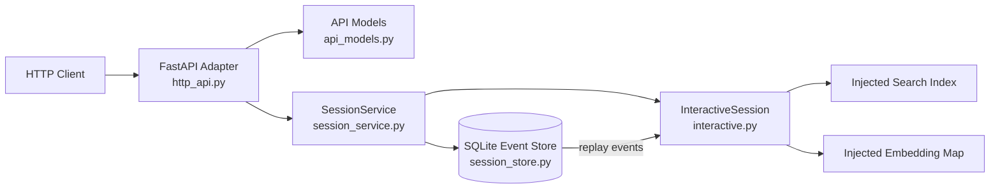

# 第三阶段 API 与 SQLite 交付

记录日期：2026 年 10 月 26 日

## 1 结论

第三阶段已完成框架无关请求/响应契约、SQLite 事件存储、进程重启恢复和 FastAPI 薄适配层。测试由 19 项增加到 25 项；本地 HTTP 生命周期烟雾测试全部通过。

当前可以通过统一服务完成“创建会话 → 检索 → 提交反馈 → 重启恢复 → 继续检索/关闭”，并自动生成 OpenAPI。尚未交付真实 FashionIQ/CIRR 在线索引启动器、鉴权、并发控制和前端，因此仍属于可集成后端，而不是可公开部署的产品。

## 2 分层架构



职责隔离：

- API Models：类型转换、必填字段和范围校验；
- FastAPI：HTTP 状态码、OpenAPI 和路由，不承载算法；
- SessionService：组织创建、检索、反馈、关闭和持久化；
- SQLite Store：事务、Schema 版本、事件日志与重启回放；
- InteractiveSession：反馈语义、幂等、曝光校验和漂移回退；
- Index/Embedding：由实际部署启动器注入，服务不隐式下载模型或数据。

## 3 HTTP 接口

| 方法 | 路径 | 用途 | 主要成功码 |
|---|---|---|---:|
| GET | `/health` | 返回编码器/索引版本和条目数 | 200 |
| POST | `/v1/sessions` | 创建去标识化会话 | 201 |
| GET | `/v1/sessions/{session_id}` | 获取会话快照 | 200 |
| POST | `/v1/sessions/{session_id}/retrieve` | 获取并记录 Top-K 曝光 | 200 |
| POST | `/v1/sessions/{session_id}/feedback` | 提交显式正负反馈或文本向量 | 200 |
| POST | `/v1/sessions/{session_id}/close` | 主动关闭会话 | 200 |

错误映射：不存在为 404，重复会话/版本冲突/非法状态为 409，字段或反馈内容错误为 422。请求禁止未声明字段，`top_k` 限制为 1—100。

OpenAPI 交付：`artifacts/api/openapi.json`。

## 4 SQLite 数据设计

Schema 版本：`1`。

`sessions` 保存：去标识化会话 ID、参考图、初始查询向量 BLOB、编码器/索引版本、反馈参数、最大轮次、状态、关闭原因和最近曝光。

`feedback_events` 保存：会话与事件联合主键、事件顺序、曝光/接受/拒绝 ID、可选文本反馈向量 BLOB、请求摘要、状态迁移和时间。原始自由文本不进入该表。

恢复过程：

1. 校验数据库 Schema 和当前加载的编码器/索引版本；
2. 用初始向量重建状态机；
3. 按事件顺序重新检索并验证曝光可复现；
4. 重放反馈并核对状态迁移；
5. 恢复未消费的最近曝光或关闭状态；
6. 任一结果不一致立即拒绝恢复，避免静默使用错误索引。

## 5 测试与验收

| 验收项 | 结果 |
|---|---|
| SQLite 建表和 Schema 版本 | 通过 |
| 曝光后重启恢复 | 通过 |
| 反馈后重启恢复 | 通过 |
| 跨重启重复事件幂等 | 通过，事件数保持 1 |
| 不同内容复用事件 ID | 拒绝 |
| 编码器/索引版本冲突 | 服务拒绝，HTTP 409 |
| FastAPI 字段校验 | 通过，错误返回 422 |
| 创建/检索/反馈/关闭 | 端到端通过 |
| OpenAPI 路由与 Schema | 已生成并检查 |
| Windows SQLite 句柄释放 | 通过，临时数据库可删除 |
| 全仓测试 | pytest `25 passed`，unittest `25 passed` |
| 依赖一致性 | `pip check` 无破损 |

机器证据：`artifacts/metrics/stage3_api_smoke.json`。

注意：Codex 的受限 Windows 文件沙箱不能创建 Python asyncio 事件循环句柄，因此 TestClient 在批准的本机执行环境运行；最小 asyncio、两条 HTTP 集成测试和全仓测试均通过。API 测试使用内存 ASGI 调用，不监听公网端口。

## 6 运行与集成

安装：

```powershell
$py = "C:\Users\25062\venvs\cir-clip\Scripts\python.exe"
& $py -m pip install -e ".[ml,dev,api]"
```

验证：

```powershell
& $py scripts\run_api_smoke.py
& $py -m pytest -q
```

应用构造入口：

```python
from cir_baseline.http_api import create_app
from cir_baseline.session_service import SessionService
from cir_baseline.session_store import SQLiteSessionStore

service = SessionService(
    index=loaded_index,
    embedding_by_id=embedding_by_id,
    store=SQLiteSessionStore("sessions.sqlite3"),
)
app = create_app(service)
```

真实部署必须显式注入已登记的索引和向量映射；当前没有默认连接 FashionIQ val，避免把研究验证集隐式变成在线产品图库。

## 7 交付边界与下一步

已完成：

- 框架无关 API 数据模型；
- SQLite v1 Schema、事务写入和事件回放；
- FastAPI 六条路由与 OpenAPI；
- 25 项测试和端到端 API 烟雾测试。

尚未完成：

- 基于正式图库的索引注册表和服务启动配置；
- 多进程/并发反馈的乐观锁或队列；
- 身份认证、授权、限流和 HTTPS；
- 前端图片网格与交互控件；
- P50/P95 延迟、并发容量和故障恢复压测；
- 用户研究所需的同意、脱敏和数据保留策略。

下一步建议先实现“索引注册表 + 本地演示页面”，仅使用登记数据或合成图库；随后增加会话版本号的乐观并发控制和延迟埋点。CIRR 官方授权到达后，再为 CIRR 注册正式索引。
