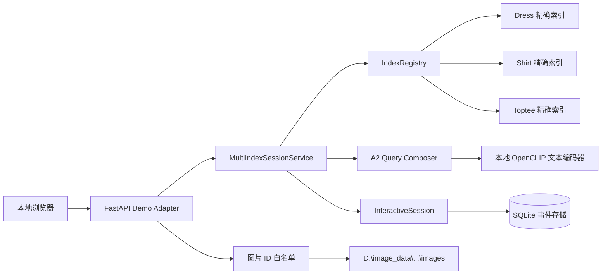
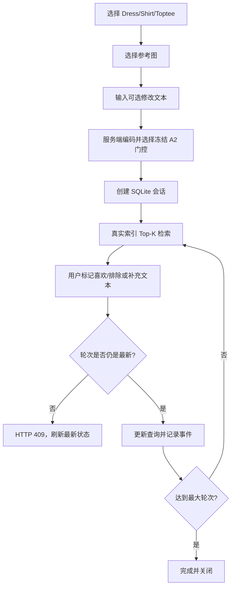

# 第三阶段真实索引与交互页面交付

记录日期：2026 年 10 月 28 日

## 1 结论

在 CIRR 原图仍未获得官方授权的情况下，第三阶段已使用现有 FashionIQ 正式图片和冻结嵌入继续推进。本轮完成真实索引注册表、按类别隔离的精确检索、多索引会话恢复、本地交互页面、服务端文本编码、图片白名单读取、单进程轮次冲突控制和滚动延迟统计。

真实验收使用 `D:\image_data` 中的 FashionIQ val 缓存和本地 OpenAI CLIP ViT-B/32 权重；三个索引分别为 Dress 3,817 张、Shirt 6,346 张、Toptee 5,373 张。全部链路检查通过。此交付是系统工程验收，不是新的 FashionIQ 或 CIRR 科研指标。

## 2 系统架构



关键边界：

- 注册表校验缓存 ID、图片路径、矩阵形状、有限数值和编码器版本；
- 索引版本包含缓存 SHA256 前缀，恢复时不允许静默换索引；
- 三个类别分别检索，避免 FashionIQ 演示中跨类别污染；
- 浏览器只能按“索引键 + 已登记图片 ID”读取图片，不能提交任意磁盘路径；
- OpenCLIP 权重按需加载，服务启动不会联网或隐式下载模型；
- 原始自由文本只在请求内编码，不写入 SQLite，数据库只保存向量；
- `expected_round_id` 检测旧页面提交，已成功事件仍可按事件 ID 幂等重试。

## 3 用户流程



## 4 查询策略

初始查询使用 `fashioniq-a2-train-frozen-v1`。有文本时先计算文本查询的 Top-1 与第 2—10 名均值之差，再按训练集冻结的类别阈值选择 A2 图像权重；显式“同款/不改变”意图使用身份门控。无文本时采用参考图向量。

页面只有一个自由文本框，而正式 FashionIQ A2 实验使用两条 caption 的正反拼接向量平均。因此页面验证的是可部署流程，不允许把页面结果当作论文基准或重新调节 val 参数。

OpenAI CLIP 与 A2 门控均基于英文 FashionIQ 描述，本地页面虽然使用中文界面，但查询文本应优先输入英文；中文检索质量没有经过校准，不能据此得出模型效果结论。

## 5 交付目标与测试目标

| 子阶段 | 交付目标 | 测试目标 | 结果 |
|---|---|---|---|
| 缓存注册 | 校验真实 NPZ、数据顺序、路径和编码器版本 | 错误 ID/路径/矩阵必须拒绝 | 通过 |
| 类别索引 | Dress/Shirt/Toptee 独立精确索引 | 数量、维度和版本可追溯 | 通过 |
| 查询组合 | 本地文本编码与冻结 A2 门控 | 编码器版本和 512 维一致 | 通过 |
| 多索引会话 | 按持久化索引版本恢复服务 | 重启后轮次、反馈和类别一致 | 通过 |
| 前端页面 | 参考图、结果网格、正负/文本反馈 | 静态资源与完整 HTTP 生命周期 | 通过 |
| 图片读取 | 仅返回登记图片 | 未登记 ID 返回 404 | 通过 |
| 并发保护 | 单进程按预期轮次提交 | 旧轮次新事件返回 409；重试保持幂等 | 通过 |
| 可观测性 | 每路由滚动 P50/P95/max | 响应头和 `/v1/demo/metrics` 可读 | 通过 |
| 回归 | 原有算法/API 不退化 | pytest 全仓 29 项 | 通过 |

## 6 真实验收证据

机器证据：`artifacts/metrics/stage3_fashioniq_demo_smoke.json`。

已检查：页面和 OpenAPI、三个真实索引、真实文本编码、参考图排除、本地图片返回、正负反馈、事件幂等、旧轮次拒绝、SQLite 重启恢复、恢复后继续检索、延迟接口和关闭会话。OpenCLIP 权重 SHA256 为 `40d365715913c9da98579312b702a82c18be219cc2a73407c4526f58eba950af`，与此前实验一致。

最终验收观测中，索引注册约 7.9 秒，首次文本会话约 10.8 秒（包含 CUDA/OpenCLIP 冷加载），预热后文本会话约 19.6 毫秒，真实 Top-12 精确内积检索约 8.9 毫秒。单次观测不能代表容量或稳定 P95；页面提供的滚动统计只用于本地诊断。

## 7 运行方式

```powershell
$py = "C:\Users\25062\venvs\cir-clip\Scripts\python.exe"

# 不启动服务，只校验真实注册表和启动参数
& $py scripts\run_fashioniq_demo.py --device cuda --check-only

# 仅监听本机 127.0.0.1
& $py scripts\run_fashioniq_demo.py --device cuda
# 打开 http://127.0.0.1:8000/

# 无公网端口的真实端到端验收
& $py scripts\run_fashioniq_demo_smoke.py --device cuda
```

启动器拒绝非回环地址。运行时 SQLite 默认写入 `artifacts/runtime/fashioniq-demo.sqlite3`，该文件不进入 Git。

## 8 已知边界与下一步

当前完成的是单进程本地演示。尚未完成：

- 多进程或多实例下的原子乐观锁；
- 登录、权限、限流、HTTPS 和数据保留策略；
- GPU 编码队列、模型预热和长期容量压测；
- 真实用户任务、满意度和交互轮次效果评测；
- CIRR 正式索引与 subset Recall，对应工作继续等待官方原图。

下一步优先实现 SQLite 原子轮次条件写入与并发压测，再编写用户研究协议。CIRR 到位后，在注册表新增 CIRR 适配项，不改变现有会话和页面主流程。

## 9 产物

| 产物 | 路径 |
|---|---|
| 真实索引注册 | `src/cir_baseline/index_registry.py` |
| 查询组合与多索引服务 | `src/cir_baseline/demo_service.py` |
| HTTP 与延迟 | `src/cir_baseline/demo_app.py` |
| 本地页面 | `src/cir_baseline/static/` |
| 启动器 | `scripts/run_fashioniq_demo.py` |
| 真实烟雾验收 | `scripts/run_fashioniq_demo_smoke.py` |
| 验收 JSON | `artifacts/metrics/stage3_fashioniq_demo_smoke.json` |
| Demo OpenAPI | `artifacts/api/fashioniq-demo-openapi.json` |
