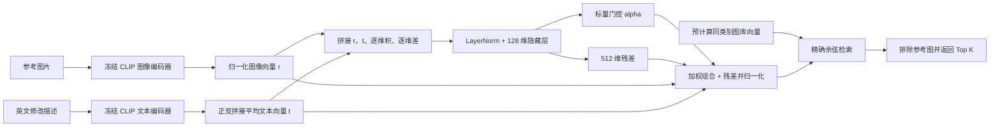
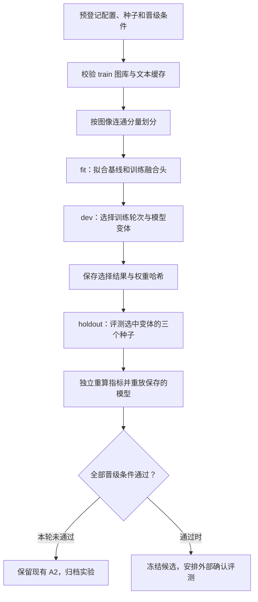

# 图文融合模型实验：冻结 CLIP 的可学习组合网络

记录日期：2026 年 10 月 28 日。实验 ID：`fashioniq-learned-fusion-train-v1`。

## 交付结论

已完成两种融合网络、三个随机种子共六次真实 GPU 训练、保存权重、内部留出集评测、独立复核和自由文本推理。残差模型三个种子的内部类别平均 R@10/R@50 为 **18.70% / 35.51%**，相对同协议重拟合 A2 提升 **0.58 / 2.11 个百分点**。R@10 提升的置信区间仍包含零，因此本轮结论是“保留研究候选，暂不替换 A2”。

本轮只用 FashionIQ train，**不能与此前官方 val 的 24.17% / 41.53% 直接比较**。现有图库、编码器和数据已经足够继续模型研究，无需等待 CIRR，也无需重复下载模型。

## 实验预登记

工作重心按用户要求转向图文检索模型。在线 API、页面和 SQLite 保持已验收版本，未完成的并发修改已撤回。本轮目标是检验能否让图文融合从规则权重变为可学习的组合网络。

方案参考 [CLIP4Cir / Baldrati 等（2023）](https://arxiv.org/abs/2308.11485) 的组合网络与对比学习思想，以及 [TIRG / Vo 等（2019）](https://openaccess.thecvf.com/content_CVPR_2019/html/Vo_Composing_Text_and_Image_for_Image_Retrieval_-_an_Empirical_CVPR_2019_paper.html) 的残差组合思路。本项目实现轻量的冻结特征融合头，没有复现其完整训练管线，也不将文献中的性能当成本项目成绩。

### 固定协议

- 数据：仅 FashionIQ 官方 train 标注与已有 train 图像/文本向量，不读取官方 val。
- 图像与文本编码器：保持 OpenCLIP ViT-B/32 及原始权重版本不变。
- 文本处理：固定为此前选择的两条 caption 正反拼接向量平均。
- 划分：参考图—目标图构成无向图，按连通分量稳定哈希分为 fit/dev/holdout，期望比例 60/20/20；同一监督图片不跨分区。
- 图库：各阶段均在完整的官方 train 同类别图库检索。共享的冻结图库不用于额外参数学习。
- 基线：image-only、text-only、等权、仅 fit 选择全局权重、仅 fit 重拟合 A2 门控。不能将原来使用完整 train 拟合的 A2 直接当作无泄漏内部基线。
- 模型消融：仅标量门控、标量门控加向量残差；每项随机种子 17/29/43。
- 训练：12 epoch；每 2 epoch 在 dev 上选择 checkpoint；以三个种子的 dev 平均 R@10（其次 R@50）选择模型变体。
- holdout：模型选择文件先落盘，再报告唯一选中变体的三个种子结果；不查看落选变体的 holdout 成绩来挑选模型。
- 门禁：相对重拟合 A2，holdout 平均 R@10 提升、三个种子均提升、平均 R@50 不退化，且连通分量配对 bootstrap 的 R@10 差值区间下限大于零。
- 模型权重保存在本地实验目录；本轮结果不自动替换页面 A2，也不等同于官方 val/test 成绩。

这是一项在已有研究数据上的内部隔离实验。caption 策略和 A2 设计历史上使用过完整 train，因此不能把新 holdout 描述为从未参与过任何研究决策的全新外部数据。需要用后续冻结的外部评测确认泛化。

### 模型与损失

输入只包含参考图向量 r 和修改文本向量 t。特征为 `[r, t, r*t, r-t]`，经 LayerNorm 和 128 维隐藏层。标量门控输出 alpha，组合向量为：

`q = normalize(alpha * r + (1-alpha) * t + 0.2 * residual(r,t))`。

残差在仅门控消融中关闭。两个输出头以零权重初始化，使初始模型准确退回图像权重 0.3 的基线。CLIP 不参与梯度更新。

训练使用同类别批次的目标图作为候选，对重复目标 ID 去重，防止将同一个正例视为负例。损失为目标对比损失，加相对初始组合向量的轻量锚定项。目标图片只用于训练损失或评价，不作为查询侧模型输入。

完整参数冻结在 `configs/learned_fusion.json`，实验登记见 `experiments/registry.csv`。

### 模型结构与执行流程



只门控模型有 266,497 个可训练参数；门控加残差模型有 332,545 个。训练期间直接读取已验证的冻结向量，不重复计算 CLIP；推理时参考图使用图库中同一版本的缓存向量，新的修改文字实时编码。当前推理入口接受已入库的参考图 ID，不包含新图片上传流程。



## 实际划分与运行记录

完整 train 图库为 45,429 张，组合查询为 18,000 条。每次检索限制在对应类别的完整 train 图库，排除查询参考图。类别平均指标是 Dress、Shirt、Toptee 的等权平均，不是把所有查询直接汇总。

| 分区 | 查询数 | 图像连通分量数 | 监督中使用的不同图像数 | 用途 |
|---|---:|---:|---:|---|
| fit | 10,666 | 4,441 | 14,916 | 梯度更新和 A2 参数重拟合 |
| dev | 3,704 | 1,576 | 5,208 | 选 epoch 和变体 |
| holdout | 3,630 | 1,451 | 5,012 | 冻结选择后的内部报告 |

三个分区的监督图像两两交集均为零。分组比例由稳定哈希决定，因此实际查询比例不要求恰好等于 60/20/20。共享图库中的图像向量始终冻结；holdout 查询和目标关联不用于梯度更新。

实际运行环境：RTX 4060 Laptop GPU、Python 3.12.2、torch 2.9.1+cu126、NumPy 2.5.4。使用已有缓存的一轮完整实验耗时 **142.679 秒**，该时长不包含初次 CLIP 编码、独立复核与后续自由文本推理。

## 实测结果与选择结论

### 开发集选模

| 变体 | 随机种子 | dev 选择的 epoch | dev R@10 | dev R@50 |
|---|---:|---:|---:|---:|
| 仅标量门控 | 17 / 29 / 43 | 均为 0 | 未超过初始模型 | 未选中此变体 |
| 门控加残差 | 17 | 2 | 18.94% | 35.64% |
| 门控加残差 | 29 | 4 | 18.27% | 35.88% |
| 门控加残差 | 43 | 4 | 18.75% | 36.93% |

残差变体依据三个种子的 dev 均值选中。仅门控三个种子最优均为 epoch 0，即训练没有超过初始化的固定 0.3 权重。残差模型较早达到最优，之后 dev 指标下降，提示目前训练有过拟合迹象；这一判断来自 dev 轨迹，不据 holdout 调参。

### 内部留出集

| 方法 | 类别平均 R@10 | 类别平均 R@50 |
|---|---:|---:|
| B0：仅参考图 | 5.38% | 12.04% |
| B1：仅修改文字 | 11.46% | 22.81% |
| B2：等权图文组合 | 13.06% | 24.58% |
| A0：fit 选择全局权重 0.3 | 17.68% | 32.73% |
| A2：仅 fit 重拟合动态门控 | 18.12% | 33.40% |
| 残差融合 seed 17 | 18.73% | 34.92% |
| 残差融合 seed 29 | 18.16% | 35.49% |
| 残差融合 seed 43 | 19.20% | 36.11% |
| 残差融合三种子均值 ± 样本标准差 | **18.70% ± 0.52 个百分点** | **35.51% ± 0.59 个百分点** |

三种子均值是分别评测三个模型再平均指标，**不是三模型集成推理**。

| 预登记晋级条件 | 结果 |
|---|---|
| 平均 R@10 超过重拟合 A2 | 通过：+0.5805 个百分点 |
| 三个种子各自 R@10 均超过 A2 | 通过 |
| 平均 R@50 不退化 | 通过：+2.1084 个百分点 |
| R@10 差值的连通分量 bootstrap 区间下限大于零 | **未通过**：95% 区间为 [-0.7094, +1.8071] 个百分点 |

统计区间由 2,000 次连通分量配对重采样得到，衡量种子平均命中率的样本不确定性；训练随机性另用三个种子的标准差报告。不能据此宣称模型已经稳定优于 A2。summary 的 `status=pass` 表示实验执行成功，真正的模型决策字段是 `decision=retain_A2_no_promotion`。

案例文件保留全部三个种子都救回/都退化的前十个 query ID，分别有 170 / 200 条满足条件。这是三个种子交集中的案例计数，不等同于平均 R@10 的净变化；仅作为存档，不用这些 holdout 案例指导下一轮参数选择。

## 验收与交付清单

| 阶段 | 交付目标 | 测试目标 | 本轮结果 |
|---|---|---|---|
| 数据隔离 | 固定 split_manifest 和缓存哈希 | 监督图像不跨分区、查询/缓存版本对齐 | 通过 |
| 模型训练 | 两种结构 × 三种子、轨迹与权重 | 初始化可回退基线、两个输入均有效、重复目标不构成假负例、梯度更新正确 | 通过 |
| 模型选择 | dev 选 epoch/变体，先保存选择再评测 | 复核每条 dev 轨迹和所选权重哈希 | 通过 |
| 排名与指标 | 每模型保存 3,630 条 Top-50 | 无重复候选、无参考图、同类别、指标可独立重算 | 通过 |
| 重现 | 加载已保存权重重跑留出集 | 8 个方法共 29,040 条排名 ID 一致，分数误差不超过 1e-6 | 通过 |
| 实际推理 | 参考图 ID + 一或两段英文描述返回 Top-K | 真实 CLIP 编码、版本校验、归一化、排除参考图 | 已运行成功，样例已保存 |
| 工程回归 | 不破坏既有检索、会话与 API | 全量测试 | **33 passed**，5.91 秒 |
| 模型替换 | 通过所有预登记统计门槛 | 区间下限必须为正 | **未通过，A2 保持原版本** |

独立验收脚本执行了 13 项核查，全部通过。复核仅重放固定模型，不进行新的参数选择。

| 可交接产物 | 路径 |
|---|---|
| 固定实验配置 | `configs/learned_fusion.json` |
| 网络、划分、损失 | `src/cir_baseline/learned_fusion.py` |
| 训练与选模入口 | `scripts/train_fashioniq_fusion.py` |
| 独立验证入口 | `scripts/verify_fusion_run.py` |
| 图文组合推理入口 | `scripts/retrieve_learned_fusion.py` |
| 指标与版本/哈希 | `artifacts/metrics/learned_fusion_train_v1.json` |
| 独立复核 | `artifacts/metrics/learned_fusion_verification.json` |
| 案例索引 | `artifacts/metrics/learned_fusion_cases.json` |
| 实际推理样例 | `artifacts/metrics/learned_fusion_inference_sample.json` |
| 测试记录 | `artifacts/metrics/learned_fusion_tests.xml` |
| 本地六份权重、轨迹、划分和完整排名 | `artifacts/fusion-runs/fashioniq-train-v1/` |

权重与完整排名位于本机仓库目录下，受 `.gitignore` 管理，**不会随 GitHub/Gitee 同步**。异机交接需另外复制该实验目录与已授权数据/缓存，或按下述命令重训。summary 中的路径按本机记录；迁机需使用新的输出路径重新生成记录。

## 使用与复现

以下命令在仓库根目录执行。当前已具备必要环境与本地 CLIP 权重。

```powershell
$py = "C:\Users\25062\venvs\cir-clip\Scripts\python.exe"

# 加载已保存的残差模型：固定用第一个预登记种子 17，不按 holdout 挑种子
& $py scripts\retrieve_learned_fusion.py --category dress `
  --reference-id B003FGW7MK `
  --text "is solid black with no sleeves" "is black with straps" --device cuda

# 复核现有实验，默认读取已保存的 summary / 权重 / 完整排名
& $py scripts\verify_fusion_run.py --device cuda

# 重训必须使用新目录，防止覆盖本轮证据
& $py scripts\train_fashioniq_fusion.py --device cuda `
  --output-dir artifacts/fusion-runs/fashioniq-train-v1-reproduction `
  --summary artifacts/metrics/learned_fusion_train_v1_reproduction.json

& $py -m pytest -q
```

推理以 FashionIQ 英文描述为适用范围；中文描述效果未验收。现有入口支持库内图片，返回 JSON 中包含图片绝对路径，可供后续页面接入。本轮完成模型研究调用，线上演示仍使用已冻结 A2。

## 下一步：保持模型优先

| 优先级 | 工作与交付目标 | 验收目标 | 责任 |
|---|---|---|---|
| 1 | 仅从 fit/dev 生成训练曲线和错误类型报告，定位过拟合与颜色/属性修改失败 | 不再读本轮 holdout 标签/排名用于开发，不调用官方 val 选参 | Codex 可继续 |
| 2 | 预登记更接近完整图库的训练目标：fit 范围内同类别困难负样本，比较现有批内对比损失；同时限制模型容量/早停 | 负样本仅来自允许的训练图像，已知正例不当负例；固定三种子，dev 报告均值和方差 | Codex 可继续 |
| 3 | 对最终选中的方案冻结代码、超参数与权重，安排独立确认评测 | 当前 holdout 已用于本轮报告，不反复查看后选优；新的结论需独立数据，或明确标为重复使用数据的探索性结果 | Codex + 团队 |
| 4 | CIRR 获批后完成完整性检查、先运行冻结基线，再确定跨数据集测试协议 | 官方来源可追溯，完整图库、全局及 subset Recall 可复现 | 用户转交回复；Codex 执行 |

用户已明确选择模型路线，无需再次确认“模型还是页面”。当前不需要额外账号、下载地址或新模型。用户需要继续跟踪 CIRR 官方回复，并在获得时转交授权与下载说明；团队负责人及正式评审时间可另行登记，不阻塞本轮训练交付。
