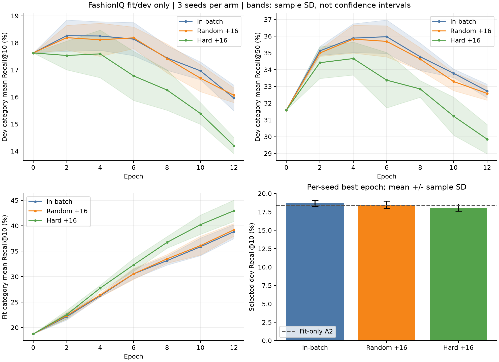

# FashionIQ 训练诊断与困难负样本实验

日期：2026-11-05。协议先登记，再执行；完整 COCO 图片下载不阻塞本实验。

## 预登记协议

- 使用已完整的 FashionIQ train 与冻结 CLIP 缓存。沿用 seed=20261028 的图像连通分量划分：fit 10,666、dev 3,704、历史 holdout 3,630 条。
- 为重建原划分会读取 train 标注；仅 fit 进入梯度、正例表和负样本挖掘。只计算 fit/dev 指标，不重新计算历史 holdout，也不加载官方 val。
- 检索评估仍使用完整 train 类别图库，参考图排除。训练负样本库只包含同类别 fit 中出现的参考图和目标图；验证图像不会成为梯度训练的负样本。
- 固定残差融合结构、冻结编码器和 `symmetric_join_mean` 文本策略。三组分别为批内负样本、批内加 16 个随机负样本、批内加 16 个困难负样本；每组种子 17/29/43，共九次训练。
- 困难候选由初始 `0.3×图像+0.7×文字` 归一化向量的余弦相似度排序，整个实验固定；随机候选固定采样 seed=20261105。每条 fit 查询保留 512 个候选次序以避开批内目标。
- 去重图片候选；排除自身参考图；相同参考图和同一组文字（统一空白、排序、不变更大小写）的全部已知 fit 目标作为正例。不同查询补充的候选互相不可见，避免困难组因候选并集较小而混入数量效应。
- 随机组和困难组每条查询都新增恰好 16 个互异、非批内目标、非参考图、非已知正例的候选。相同种子的三组模型初始化、批次次序、优化器、训练轮数一致；结束时核对批次哈希和候选计数。
- 沿用旧实验超参数：batch 256、hidden 128、dropout 0.1、AdamW lr 0.001、weight decay 0.0001、温度 0.07、残差系数 0.2、锚定系数 0.02、12 轮，每 2 轮评估并含第 0 轮。
- 每个种子按 dev 类别平均 R@10、再 R@50 选择权重，相同则保留更早轮。报告全部种子和均值/样本标准差，不只报告最好种子。
- 本轮仅为开发证据。开发集已多次用于选模，不能把其增益当作独立泛化提升；不据此替换已部署 A2。未标注的正确匹配仍可能被当作负例。

## 交付与验收目标

| 任务 | 交付物 | 验收 |
|---|---|---|
| 旧模型诊断 | fit/dev 指标、原验证曲线、按类别的救回/退化/Top-50 外案例 | 仅使用 fit/dev；案例按固定 query ID 顺序抽取 |
| 配对消融 | 九个训练记录、最佳权重、逐轮 fit/dev 指标、三种子汇总 | 批次顺序一致；困难/随机候选数量一致；无跨划分采负 |
| 可靠性 | 候选屏蔽测试、独立重算与权重复跑 | 指标可由保存结果复算，权重输出一致 |
| 可交接性 | 协议哈希、代码/数据哈希、图表、实验结论、断点 | 中断后相同环境可续跑；结果完成后禁止原地重写 |

## 执行与恢复

```powershell
$py = 'C:\Users\25062\venvs\cir-clip\Scripts\python.exe'
& $py scripts\train_fashioniq_hard_negatives.py
# 仅未完成、协议/代码/缓存/环境未变的实验可恢复：
& $py scripts\train_fashioniq_hard_negatives.py --resume
& $py scripts\analyze_fashioniq_hard_negatives.py
& $py -m pytest -q
```

每轮保存模型、优化器、随机状态和进度。完成的组恢复时跳过；完整实验结束后拒绝覆盖。断电可能损失正在执行的一轮，已完成轮从原子保存的断点继续。权重、负样本库和大体积排名保存在本地 `artifacts/fusion-runs/fashioniq-hard-negatives-dev-v1/`，不进入 Git。

代码入口：`configs/fashioniq_hard_negatives.json`、`src/cir_baseline/hard_negatives.py`、`scripts/train_fashioniq_hard_negatives.py`、`tests/test_hard_negatives.py`。机器可读协议在启动时写入 `protocol.json`，在训练前记录时间、配置、代码与数据哈希。

## 实测结果

九次训练已完成，训练进程耗时 251.668 秒（包含旧模型诊断与负样本库构建，不包含后续复核/绘图）。结论：**本次固定最相似负样本策略未带来开发集增益，保留已部署 A2。**

以下均为 train 内部 dev 的类别平均 Recall，与历史 holdout、官方 val 指标不是同一评测集。均值和标准差来自三个种子，各自选择最佳 dev 轮。

| 方法 | dev R@10（%） | dev R@50（%） | 最佳轮：17 / 29 / 43 |
|---|---:|---:|---|
| 仅 fit 拟合的 A2 | 18.39 | 32.23 | 不训练融合网络 |
| 批内负样本 | 18.65 ± 0.41 | 36.12 ± 0.88 | 2 / 4 / 6 |
| 批内 + 16 个随机负样本 | 18.47 ± 0.51 | 35.57 ± 1.03 | 2 / 2 / 4 |
| 批内 + 16 个困难负样本 | 18.09 ± 0.49 | 34.20 ± 2.27 | 2 / 0 / 4 |

困难组相对批内组 R@10 降低 **0.56 个百分点**，相对等量随机组降低 **0.38 个百分点**；三个配对种子方向均为下降。困难组 seed29 最优权重为第 0 轮，即训练没有超过初始化。当前证据只否定本次配置，不代表所有困难负样本方法无效。

本轮批内对照也使用显式参考图排除和条件多正例处理，与历史 v1 的单目标批内损失不完全相同。随机/困难消融的三组共享这些处理，不能把新旧批内差异直接归因于某一个修正。

### 分类别诊断

| 方法 | dress R@10（%） | shirt R@10（%） | toptee R@10（%） |
|---|---:|---:|---:|
| A2，fit 拟合 | 15.56 | 20.39 | 19.21 |
| 批内，三种子均值 | 14.71 | 20.73 | 20.52 |
| 随机 +16，三种子均值 | 14.39 | 20.99 | 20.04 |
| 困难 +16，三种子均值 | 14.34 | 20.49 | 19.44 |

dress 是本轮明显薄弱项；总体 R@50 较高不能掩盖其 R@10 退化。尚未开展按类别的额外调参。

### 过拟合证据

旧残差模型在最佳 dev 权重下，三个种子的 fit/dev R@10 分别为 **22.87/18.94、25.96/18.27、26.67/18.75（%）**。旧训练曲线显示损失继续下降，但 dev 常在第 2～4 轮之后下降。

新实验第 12 轮进一步展示同样问题：

| 方法 | 第 12 轮 fit R@10（%） | 第 12 轮 dev R@10（%） |
|---|---:|---:|
| 批内 | 38.84 | 15.96 |
| 随机 +16 | 39.20 | 16.06 |
| 困难 +16 | 42.95 | 14.20 |

这里的末轮指标用于训练诊断，最终候选仍由预登记的最佳 dev 规则选择。曲线阴影为三个种子的样本标准差，**不是置信区间**。图中跨组损失没有直接比较，避免不同候选分母带来的误导。



旧模型曲线：`artifacts/figures/fashioniq_prior_training_curves.png`；两组图均附 PDF 供报告排版。

### 开发集失败案例

固定旧残差 seed17，不按本轮结果挑选模型；每个类别按 query ID 排序抽取救回、退化、Top-50 外各两例，共 18 条结构化记录，九例本地图像对照。seed17 相对 A2 在 dev 上救回 272 条、退化 252 条，仍有 2,385 条目标在 Top-50 外。救回/退化数量是查询计数，不能直接替代类别宏平均指标。

人工查看固定案例后的观察（不代表全体比例，也未改变标注）：

- 参考图 `B002CFUSUI` 的指令包含 “Ford”，目标 `B0087F5KTG` 上可见 Ford 标识；模型 Top-1 返回另一种图案，目标从 A2 第 2 名退到 Top-50 外。细粒度文字/标识约束值得单独统计。
- 参考图 `B000FLD4AC` 要求浅粉色无袖，Top-1 命中粉色无袖的大方向，但颜色深浅、衣长与指定目标不同。粗粒度颜色命中不等于指定目标命中。
- 参考图 `B003FGW7MK` 要求黑色无袖，Top-1 与标注目标都具有黑色无袖外观。这提示未标注有效匹配可能存在；不能凭此把任意相似图自动改成正例，也不能断言这就是困难组退化的唯一原因。

因此下一轮应优先验证较弱/较少的困难负样本和更强的泛化约束；不直接扩大最高相似负样本数量。

## 负样本与可靠性验收

- 同类别 fit 图像池：dress 4,766、shirt 5,202、toptee 5,124。存在跨类别共享图片，三者不可相加当作唯一图片总数。
- 106 条 fit 查询具有多个已知目标，最多 3 个，均作为正例保护。正例关系未使用 dev/holdout 标注。
- 随机/困难两组新增负样本的平均初始余弦相似度约 **0.46318 / 0.54601**，确认困难组确实更相似。
- 每个种子的三组批次哈希一致；随机/困难组新增候选计数、有效候选总数一致；跨 fit/dev/holdout 的监督图像交集为 0。
- 全仓 **49 项测试通过**（4.28 秒），包括候选去重、多正例、参考图屏蔽、候选库隔离，以及中文目录中的 CPU/GPU 中断恢复。恢复后权重、随机状态、训练轨迹与不中断运行逐项相同。
- **66 项实验复核通过**；重载九个权重，验证选轮和种子汇总；归档 **33,336 条 dev Top-50 排名**。重载后的指标与原训练记录完全一致。另用 Python 计数独立重算 Recall，浮点求和差异最大约 `5.55e-17`，验收容限 `1e-12`。

复核时修复了 Windows 默认编码读取 UTF-8 中文路径的问题，并补自动源码快照。九次原训练没有重跑或改权重；训练前登记的原始源码逐字保留、哈希校验，并归档到 `artifacts/provenance/fashioniq-hard-negatives-dev-v1-sources.zip`。验证 JSON 明列当前训练脚本与登记版本的差异哈希，避免把后续维护冒充原实验源码。

首次完整回归在受限运行环境中卡于本地应用测试，已结束该测试进程并在正常本机环境完成全部回归。下载进程未受影响。

## 交付文件与复现边界

| 文件 | 内容 | Git 同步 |
|---|---|---|
| `configs/fashioniq_hard_negatives.json` | 预登记协议与超参数 | 是 |
| `scripts/train_fashioniq_hard_negatives.py` | fit/dev 训练、断点和候选审计 | 是 |
| `scripts/analyze_fashioniq_hard_negatives.py` | 权重复跑、独立计数、图表与源码归档 | 是 |
| `src/cir_baseline/hard_negatives.py` | 采样池与逐查询候选屏蔽 | 是 |
| `tests/test_hard_negatives.py`、`tests/test_hard_negative_resume.py` | 采样和恢复验收 | 是 |
| `artifacts/metrics/fashioniq_hard_negatives_dev_v1.json` | 九次训练结果和候选计数 | 是 |
| `artifacts/metrics/fashioniq_hard_negatives_training_curves.json` | 全部九次逐轮 fit/dev 指标 | 是 |
| `artifacts/metrics/fashioniq_hard_negatives_verification.json` | 66 项复核、排名与源码哈希 | 是 |
| `artifacts/metrics/fashioniq_prior_fit_dev_diagnosis.json` | 旧模型曲线、开发集转移和 18 条案例 | 是 |
| `artifacts/metrics/hard_negatives_contract_tests.xml` | 49 项回归证据 | 是 |
| `artifacts/figures/fashioniq_*training_curves.*`、`fashioniq_hard_negatives_curves.*` | PNG/PDF 图表 | 是 |
| `artifacts/provenance/fashioniq-hard-negatives-dev-v1-sources.zip` | 原始登记源码和协议 | 是 |
| `artifacts/fusion-runs/fashioniq-hard-negatives-dev-v1/` | 九个最佳权重、断点、负样本库、完整排名、九例图像对照 | 否，本机保留 |

绘图库安装入口：`pip install -r requirements-analysis.txt`，或项目可选依赖 `.[analysis]`。已有 ML 环境不需要重新下载 CLIP 权重。完整复跑需要原 FashionIQ 图片/向量缓存；仅克隆仓库不包含这些大文件。

已完成实验禁止原地重跑。若从当前维护版本重新复现，请另指定输出目录和 summary，例如：

```powershell
& $py scripts\train_fashioniq_hard_negatives.py --output-dir artifacts\fusion-runs\fashioniq-hard-negatives-dev-v1-repro --summary artifacts\fusion-runs\fashioniq-hard-negatives-dev-v1-repro\summary-copy.json
```

## 后续交接任务

| 顺序 | 下一步 | 交付和测试目标 | 是否等待完整图片 |
|---|---|---|---|
| 1 | 预登记小范围正则化/较低学习率对比，保留相同三种子和 fit/dev | 三种子最佳轮、训练/开发差距、类别退化分析；开发集结果不升级为独立测试结论 | 否 |
| 2 | 对疑似误负例建立抽样审查表，再决定是否试较弱或降权负样本 | 可追溯图像/文字记录；仅人工确认或明确规则处理，不静默改原标注 | 否 |
| 3 | 完成 LaSCo 批量训练入口、向量缓存和断点恢复 | 小批真实训练通过；整包校验后才扩大训练 | 代码可先做，大规模训练需等待 |
| 4 | 完成 CIRCO 多正例 mAP 评测入口 | 人工可核算小例和工程测试；模型冻结后在完整图库正式评测 | 评测代码可先做，正式指标需等待 |

当前截图式下载状态（2026-11-05 14:18，北京时间）：`unlabeled2017` 已确认完成 **3,674,210,304 / 20,126,613,414 字节，约 18.3%**。这是第一个归档，不是三包总进度；另外两包仍在顺序队列。分块续传和完成后校验进程运行中。

用户本轮无需提供账号、模型或重新整理数据。只需在下载时保持联网且不休眠，继续等待 CIRR 官方邮件；本轮没有替用户发送邮件，也没有宣称 CIRR 图片已获授权。
