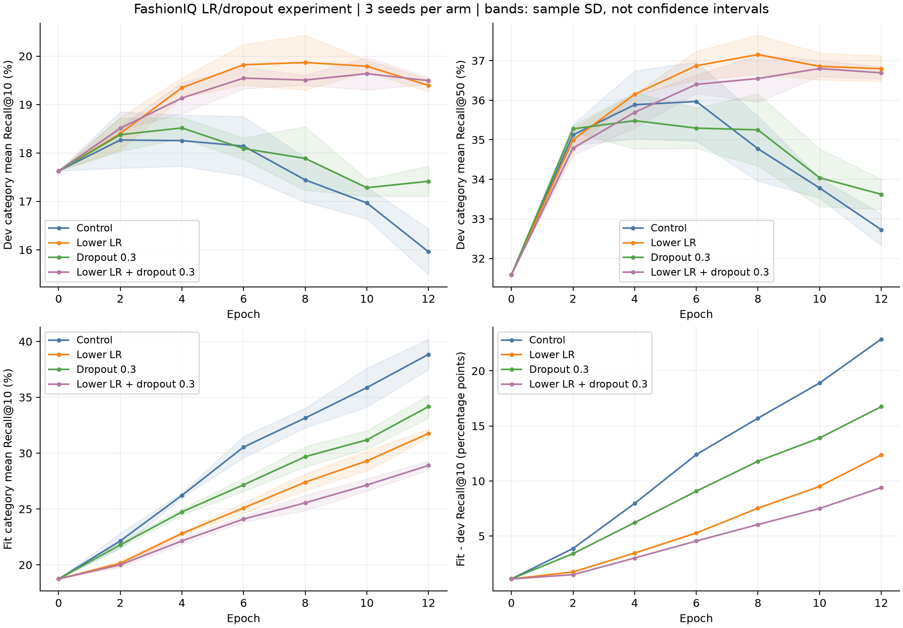

# FashionIQ 学习率与 Dropout 对比实验

日期：2026-11-05。承接 docs/20 的过拟合诊断；以下协议先登记、后训练，现已完成 12 次训练和独立复核。

## 预登记设计

只调整学习率和 Dropout，采用 2×2 配对实验，避免同时改变多个正则化项而无法归因。

| 组别 | 学习率 | Dropout | 作用 |
|---|---:|---:|---|
| control | 0.001 | 0.1 | 完整重跑上轮批内对照 |
| low_lr | 0.0003 | 0.1 | 仅降低学习率 |
| high_dropout | 0.001 | 0.3 | 仅提高训练时随机失活比例 |
| low_lr_high_dropout | 0.0003 | 0.3 | 两者结合 |

- 每组三个固定种子 17、29、43，共 12 次训练；每次 12 轮，在第 0、2、4、6、8、10、12 轮计算 fit/dev 指标。若最佳轮为第 12 轮，记录为训练预算边界，不在看过结果后自动追加轮数。
- 数据和缓存与上一轮一致：train 内部图像连通分量划分，fit 10,666、dev 3,704 条。训练监督、条件多正例、候选负图均只来自 fit；检索使用完整 train 类别图库。
- 同种子共享参数初始化、批次顺序和候选屏蔽；不添加困难负样本。冻结 CLIP、文本策略、网络结构、batch 256、weight decay 0.0001、温度 0.07、锚定系数 0.02、残差系数 0.2 均不改变。
- 每个种子按 dev 类别平均 R@10、再 R@50 选权重，并列选更早轮。组间按三个种子的最佳 dev R@10 均值、再 R@50 均值选候选；报告所有组、全部种子和类别指标。
- 开发候选筛选门槛：相对 control 平均 R@10 至少增加 0.5 个百分点、三个配对种子 R@10 都提高、平均 R@50 不下降。通过此门槛也仅可优先考虑独立确认评测，不直接替换 A2。
- 不重新评估历史 holdout，不加载 FashionIQ 官方 val。dev 已经多次用于开发，不能把本轮提升当作独立泛化证据。

## 实现与验收目标

1. 复用已经验证的训练内核及 CPU/GPU 断点恢复，新增严格四组协议检查，不修改历史训练算法。
2. 每个 control 的完整 fit/dev 轨迹、最佳指标和权重张量须与上一轮批内模型完全一致；否则停止并调查。
3. 同种子四组的批次哈希、候选计数一致；登记源码、有效配置、缓存、监督关系哈希。
4. 保存 12 次训练的曲线、最佳权重和断点；独立重载权重、重算检索指标和汇总，输出逐类别差异与训练/开发差距。
5. 报告包含负面结果和预算边界；不凭单一最好种子宣称提升。
6. 训练完成后，用选中组的固定 seed17 权重做一次真实文本编码和检索工程检查：沿用旧样例参考图 `B003FGW7MK` 与 “is solid black with no sleeves” / “is black with straps”。该样例只验收推理链路，不用于选组、选种子或宣称性能提升。

## 执行入口

```powershell
$py = 'C:\Users\25062\venvs\cir-clip\Scripts\python.exe'
& $py scripts\train_fashioniq_regularization.py
# 仅适用于尚未完成、协议和环境未改变的实验：
& $py scripts\train_fashioniq_regularization.py --resume
& $py scripts\analyze_fashioniq_regularization.py
& $py -m pytest -q
```

配置为 `configs/fashioniq_regularization.json`；本地运行目录为 `artifacts/fusion-runs/fashioniq-regularization-dev-v1/`。大体积权重、断点和完整排名不进入 Git。已完成实验拒绝原地覆盖。

## 实测结果

**结论：优先保留仅降低学习率的 low_lr 配置作为开发候选。** 学习率从 0.001 降为 0.0003，Dropout 仍为 0.1。开发集平均 R@10 从 18.65% 提高至 20.11%，增加 **1.45 个百分点**；三个配对种子均提升。平均 R@50 从 36.12% 提高至 37.11%，增加 **0.99 个百分点**。

完整训练进程耗时 386.923 秒，不含后续权重复跑、绘图和真实文字推理。没有重测历史 holdout 或官方 val，没有替换演示默认 A2。

### 全部四组结果

| 方法 | dev 类别平均 R@10（%） | dev 类别平均 R@50（%） | 最佳轮：17 / 29 / 43 | 开发筛选 |
|---|---:|---:|---|---|
| control | 18.65 ± 0.41 | 36.12 ± 0.88 | 2 / 4 / 6 | 对照 |
| low_lr | **20.11 ± 0.41** | **37.11 ± 0.50** | 6 / 8 / 8 | 通过，选中 |
| high_dropout | 18.67 ± 0.06 | 35.57 ± 0.62 | 2 / 4 / 4 | 未通过 |
| low_lr_high_dropout | 19.80 ± 0.23 | 36.72 ± 0.22 | 10 / 12 / 6 | 通过，均值低于 low_lr |

“±”是三个种子的样本标准差，不是置信区间。每个种子按预登记规则独立选轮；三种子均值不是模型集成预测。组间开发筛选通过仅说明值得进一步确认，不能替代独立测试。

low_lr 对照明细：

| 种子 | control dev R@10（%） | low_lr dev R@10（%） | 增加百分点 |
|---|---:|---:|---:|
| 17 | 18.94 | 20.14 | +1.20 |
| 29 | 18.18 | 19.68 | +1.50 |
| 43 | 18.84 | 20.51 | +1.66 |

单独提高 Dropout 的 R@10 均值只增加约 0.02 个百分点，且 R@50 下降约 0.56 个百分点；两个种子 R@10 下降。结合两项调整也能提升，但在本轮固定预算内未超过仅降低学习率。联合组 seed29 的最佳轮到达第 12 轮预算边界，已明确标记，未追加训练；这不是对其所有训练预算的否定。

### 类别与过拟合诊断

| 类别 | control dev R@10（%） | low_lr dev R@10（%） | 增加百分点 |
|---|---:|---:|---:|
| dress | 14.71 | 16.15 | +1.44 |
| shirt | 20.73 | 22.01 | +1.28 |
| toptee | 20.52 | 22.17 | +1.65 |

三个类别的种子平均指标都提高，上一轮较弱的 dress 也有改善。

| 诊断时点/配置 | fit R@10（%） | dev R@10（%） | 差距（百分点） |
|---|---:|---:|---:|
| 各自最佳轮 control | 26.47 | 18.65 | 7.82 |
| 各自最佳轮 low_lr | 26.63 | 20.11 | 6.53 |
| 第 12 轮 control | 38.84 | 15.96 | 22.89 |
| 第 12 轮 low_lr | 31.77 | 19.40 | 12.37 |

降低学习率减轻了本轮训练后期的退化，但仍存在训练/开发差距，不能称为解决了过拟合。提高 Dropout 也会缩小差距，却未同等提高检索指标，因此不能只按差距选模型。



同名 PDF 可用于报告排版。图中曲线是每个固定轮次的三种子均值，表格是每个种子各自最佳轮的均值；两者不必在同一横坐标重合。简单因素对比（固定另一因素时的变化）见 diagnostics JSON，未进行未登记的大范围调参或显著性宣称。

## 验收结果

- 全仓 **55 项测试通过**（5.78 秒），包括协议边界、种子缺失拒绝、平均提升不能掩盖单种子退化、既有 CPU/GPU 断点恢复，以及并列排名校验。
- 三个 control 的完整逐轮轨迹、最佳指标、权重张量与上轮批内组完全一致，排除了对照漂移。
- 同种子四组的批次哈希、样本数、有效候选总数一致；初始 fit/dev 指标一致；没有额外困难负样本。
- **102 项模型复核通过**：检查登记源码/当前源码一致、配置、缓存、监督关系、权重、选轮、配对候选与汇总；12 个保存权重重载后的指标与训练记录完全一致。
- 归档 **44,448 条 dev Top-50 排名**，并从图片 ID 命中关系独立重算 Recall，数值容限 `1e-12`。该复核是实现正确性验证，不是新的独立泛化评测。
- **11 项真实检索检查通过**：固定参考图与原始英文文字经本地 CLIP 编码，使用 low_lr seed17 第 6 轮权重，返回 10 张互异且不含参考图的结果，图片路径均可访问。

### 并列排名边界

最初按“Top-10 ID 顺序完全一致”检查时未通过，原结果保留为 `fashioniq_regularization_inference_exact_order_check.json`。调查发现：真实推理使用 NumPy 精确检索，离线评测使用 FAISS；本样例第 7～10 位四个 ID 的缓存向量逐元素完全相同，两个实现给出的并列顺序不同，Top-10 图片集合完全相同。两条计算链路的最大分数差为 `1.7881393432617188e-7`。

最终工程校验保留 `exact_id_order_equal=false`，要求集合完全一致、重排位置的向量严格相同、分数在 `1e-5` 内一致。仅分数接近但向量不同、图片集合改变或出现重复 ID 都不会通过。此次未修改检索实现、排序规则、训练结果或科研指标；跨后端的并列排序仍是明确记录的接口差异，后续统一规则时应单独版本化评测。

## 候选使用方式

候选清单：`artifacts/metrics/fashioniq_regularization_candidate_manifest.json`。选组依据为三种子 dev 均值；工程试用固定 seed17，没有挑选表现最好的种子。它是研究候选，不是默认线上模型，也不是三个权重的集成。

本机权重：`artifacts/fusion-runs/fashioniq-regularization-dev-v1/low_lr/in_batch-seed17.pt`；SHA256：`977d546ebce7733864b9e4ae0a43c0b29a902222be8f709719718e1397b9759e`。

在仓库根目录运行：

```powershell
$py = 'C:\Users\25062\venvs\cir-clip\Scripts\python.exe'
$candidate = Get-Content artifacts\metrics\fashioniq_regularization_candidate_manifest.json -Raw -Encoding UTF8 | ConvertFrom-Json
& $py scripts\retrieve_learned_fusion.py --fusion-checkpoint $candidate.checkpoint --reference-id B003FGW7MK --category dress --text 'is solid black with no sleeves' 'is black with straps' --top-k 10 --output artifacts\metrics\fashioniq_regularization_inference_sample.json
& $py scripts\verify_fashioniq_candidate_inference.py
```

可将参考图 ID、类别和英文描述换成已有 train 图库中的其他组合进行研究试用；最后一条固定样例校验命令仅适用于上述原样例。输入只包含参考图和文字，不传目标图片 ID。当前入口按 FashionIQ 英文文本设计，未验证中文文本效果。

## 交付清单与复现

| 文件 | 内容 |
|---|---|
| `configs/fashioniq_regularization.json` | 四组预登记配置、预算和筛选规则 |
| `scripts/train_fashioniq_regularization.py` | 配对实验、对照复现、断点恢复调度 |
| `scripts/analyze_fashioniq_regularization.py` | 12 个权重复核、44,448 条排名、曲线、源码归档、候选清单 |
| `scripts/verify_fashioniq_candidate_inference.py` | 原始文本推理与缓存评测的固定样例检查，含严格并列向量判断 |
| `tests/test_regularization_protocol.py`、`tests/test_candidate_inference_verification.py` | 本轮新增 6 项测试 |
| `artifacts/metrics/fashioniq_regularization_dev_v1.json` | 全部 12 次训练结果、对照复现和开发筛选 |
| `artifacts/metrics/fashioniq_regularization_training_curves.json` | 完整逐轮 fit/dev 指标 |
| `artifacts/metrics/fashioniq_regularization_diagnostics.json` | 类别、差距、最佳轮、预算边界和简单因素对比 |
| `artifacts/metrics/fashioniq_regularization_verification.json` | 102 项复核与排名/源码哈希 |
| `artifacts/metrics/fashioniq_regularization_candidate_manifest.json` | 固定试用权重、哈希和研究用途标记 |
| `artifacts/metrics/fashioniq_regularization_inference_sample.json` | 真实文字编码与 Top-10 输出 |
| `artifacts/metrics/fashioniq_regularization_inference_verification.json` | 11 项工程检查和并列排序说明 |
| `artifacts/metrics/regularization_contract_tests.xml` | 55 项回归证据 |
| `artifacts/figures/fashioniq_regularization_curves.png`、同名 `.pdf` | 可查看和排版的训练曲线 |
| `artifacts/provenance/fashioniq_regularization_sources.zip` | 训练时实际源码与登记协议 |

上述代码、小体积结果、文档和图表随 Git 同步。12 组权重/断点、全部排名及源码快照另保留于本地运行目录；图片和向量缓存仍在 `D:\image_data`，不会随仓库克隆。

训练入口还依赖 docs/20 的本地运行目录 `artifacts/fusion-runs/fashioniq-hard-negatives-dev-v1/`，用于读取登记协议、summary、三个旧批内权重和训练轨迹。换机器仅克隆仓库不足以直接复跑；需准备数据/缓存并按 docs/20 重建前置实验及本机路径。严格对照复现若不一致会中止，不能跳过后继续报告可比结果。

复跑已完成实验需使用新目录，以免覆盖本轮证据：

```powershell
& $py scripts\train_fashioniq_regularization.py --output-dir artifacts\fusion-runs\fashioniq-regularization-dev-v1-repro --summary artifacts\fusion-runs\fashioniq-regularization-dev-v1-repro\summary-copy.json
& $py scripts\analyze_fashioniq_regularization.py --run-dir artifacts\fusion-runs\fashioniq-regularization-dev-v1-repro --artifact-prefix fashioniq_regularization_repro
```

## 下一步交接目标

| 顺序 | 工作 | 可验收交付 | 数据依赖 |
|---|---|---|---|
| 1 | 完成 LaSCo 批量训练入口和冻结 CLIP 缓存 | 缓存/清单版本检查、可恢复训练、小批真实 train 梯度验证；禁止缺图悄悄改变实验样本 | 可先写代码；全量运行需完整图片 |
| 2 | 完成 CIRCO 多正例 mAP 评测入口，固定比较方案 | 人工可核算小例、候选/参考图排除、完整图库门禁、逐查询结果 | 代码和单元验收可先做；正式指标需完整图库 |
| 3 | 固定候选权重及跨数据集协议，再进行独立确认 | 报告冻结 CLIP 基线与本轮候选的差异，不用确认集继续选学习率 | CIRCO 完整图库，或 CIRR 官方授权图片到位 |
| 4 | 整理疑似误负例与重复向量审查表 | 可追溯样例、人工确认依据和版本化处理；不静默重写原始标注 | 现有 FashionIQ 即可 |

本轮已有开发候选后，优先推进数据扩展和独立确认，不继续在同一 dev 上无界搜索参数。LaSCo 全量批量训练和 CIRCO 完整评测仍未交付，不把上述计划标成完成。

下载快照（2026-11-05 14:42，北京时间）：第一个归档 `unlabeled2017` 已完成 **3,741,319,168 / 20,126,613,414 字节，约 18.6%**；后续两包仍在顺序队列。这不是三包总进度。本轮用户无需提供账号或新模型，保持下载联网、不休眠并等待 CIRR 官方回复即可。
