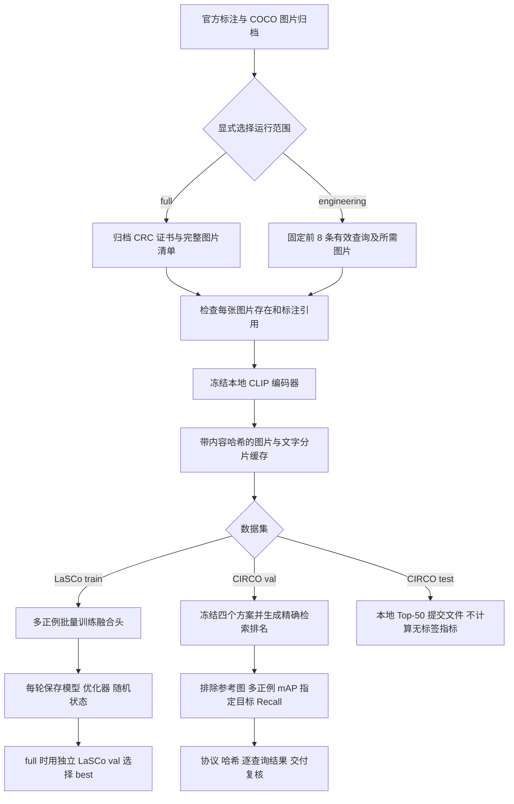

# LaSCo 批量训练与 CIRCO 评测交付

交付日期：2026-11-05。承接文档 19、21，优先推进图文检索模型。

## 1. 本次交付结论

已实现并实测可恢复的 CLIP 分片缓存、LaSCo 多正例批量训练和 CIRCO 多正例评测入口。全仓 **67 项测试通过**，真实小样本 **22 项交付复核通过**，与官方 CIRCO 代码的 **17 项指标对拍通过**。

完整 COCO 图片尚未通过归档验收，因此全量 LaSCo 训练、CIRCO 完整图库评测均未运行。下述小样本仅证明代码可以编码、训练、恢复和检索，不能写成模型准确率提升或正式数据集成绩。现有演示仍使用 A2；旧 FashionIQ holdout 和官方 val 未参与本轮开发。

| 交付项 | 本次完成 | 验收证据 |
|---|---|---|
| 分片特征缓存 | 图片/文字分批编码；内容与版本校验；进程锁；原子写入；中断续跑 | LaSCo 第一分片中断后原样保留，14 图片、8 文字最终完整 |
| LaSCo 批量训练 | 批内目标去重；同条件多正例；参考图排除；独立 val 选轮次；按轮恢复 | 8 条真实 train 查询、3 轮、每轮 2 批；连续/恢复权重逐元素及文件哈希一致 |
| CIRCO 评测 | mAP@5/10/25/50、指定目标 Recall、语义分组 mAP@10；Top-50 导出 | 官方示例的 220 条查询、17 项指标最大误差 8.67×10⁻¹⁹ |
| 真实 CIRCO 检索 | 固定的图像、文字、0.3 加权、FashionIQ low_lr seed17 四种方案 | 42 张图片、8 条查询、32 组排名；每组 41 个非参考图结果，导出结果独立重算一致 |
| 正式实验完整性检查 | 校验归档证书、图片清单、标注、特征版本和候选权重 | 当前三组完整数据检查均明确提示等待完整归档，不自动降级为小图库 |
| 官方图库元信息 | 已下载、校验 CRC 和 SHA256 | COCO unlabeled2017 清单 123,403 张，约 4.9 MB 元数据压缩包 |

机器证据：`artifacts/metrics/additional_pipeline_tests.xml`、`additional_pipeline_verification.json`、`circo_official_metric_parity.json`。

## 2. 数据和模型流程



CLIP 始终冻结，只训练融合头。默认完整训练配置使用 hidden=128、Dropout=0.1、学习率 0.0003、batch=256、6 轮、seed=17/29/43。初始图像权重 0.3，残差缩放 0.2、温度 0.07、锚定惩罚 0.02。该配置预先固定，尚未证明适合完整 LaSCo。

LaSCo 正例按“参考图 ID + 仅规范空白的修改文字”归组；相同条件的已知目标均作为正例，目标去重，参考图从损失候选中屏蔽。目标图仅用于损失监督，不进入查询融合头。每轮仅末尾不足 2 条的批次跳过，并记录实际训练样本数。

full 训练必须同时提供完整 train 和 val 缓存，且图库 ID 不重叠。LaSCo train 有效 359,167 条，隔离 101 条；val 有效 30,031 条，隔离 6 条。选模使用项目预登记的“全 COCO val2014 图库 + LaSCo val 指定目标”R@10，R@50 打破并列，再并列保留较早轮次；这不是另行宣称的官方 LaSCo 论文评测协议。

## 3. 版本与恢复规则

- 本地 CLIP：`C:\Users\25062\.cache\clip\ViT-B-32.pt`，编码器版本 `open_clip:ViT-B-32:local-sha256:40d365715913c9da|quick_gelu=1`。
- 缓存包含完整计划、标注 SHA256、编码器/依赖版本、图片内容 SHA256、各分片哈希、图片和查询 ID。默认单次编码 32 条、分片 256 条，避免一次把全部原图送入显卡。
- 同一路径再次运行缓存命令会校验已完成分片及其原图内容，再继续未完成分片；配置、编码器或源图片发生变化时要求使用新缓存目录。
- `load_cache` 校验已冻结的缓存文件、版本和完整覆盖，不在每次训练时重新读取全部原图。若原图更新，应先重新执行构建检查或建立新版本；不能手工改 state 文件绕过检查。
- 缓存加载会在 CPU 内存中展开矩阵，全量 LaSCo train 的 359,167×512 float32 文字矩阵约 735.6 MB，此外还有图片矩阵、标注与索引。全量实际资源峰值待测。
- 训练恢复点为**完整一轮结束后**。保存模型、优化器、NumPy/Torch/CUDA 随机状态和选模记录；中途关机会重新执行未完成的这一轮。
- 恢复要求配置、数据缓存、训练源码、Torch 版本和设备契约一致。修改配置开展新实验应使用新输出目录。
- 不覆盖已有 CIRCO 评测目录；test 只导出本地预测，不自动上传评测服务器。

真实恢复证据：第一缓存分片 SHA256 为 `f4e89b13a55749cf91a4dfe97f1d4ed482417dc9da7de2eb3116fdc40a3dfd91`，中断前后相同。两次训练的 final.pt 均为 `cf9fcc21b668cc6561a52365dff9d7d5a62d7bf59f0b2c2d04cf57ab95480b8c`。三轮损失为 0.538913、0.428775、0.380577；这是微型训练的优化器检查，不证明泛化性能。

## 4. CIRCO 评测口径与冻结方案

[官方 evaluation.py](https://github.com/miccunifi/CIRCO/blob/main/src/evaluation.py) 将前 K 位正例的 precision 相加，再除以 `min(该查询全部正例数, K)`，随后对查询取平均得到 mAP@K。Recall 仅看标注的 `target_img_id`，不是“命中任一正例”。本项目保存 0—1 小数，展示百分比时才乘 100。

`verify_circo_official_metrics.py` 读取官方仓库 `ba9a9346a8840513bc5d0beccdaf6dd0f5c3c6fa` 的未修改指标代码，只用标注读取器代替需要原图目录的 Dataset。官方示例 query 189 含参考图 550727，项目要求排除参考图，因此在内存中移除并补入一个不相关的图库图片 533083；同一份处理后的预测交给两套代码。原文件保持不变，原始和处理后输入哈希均存档。17 项包括 4 个 mAP、4 个 Recall、9 个语义组 mAP@10；它们是外部示例的计算对拍，不是本项目模型的 220 条正式评测。

正式 CIRCO 协议已写入 `configs/circo_evaluation.json`：

| 项目 | 冻结内容 |
|---|---|
| 图库 | 官方 COCO unlabeled2017 全部 123,403 张，完整 ID→文件名映射一致 |
| 查询 | val=220；test=800 |
| 文字 | `shared_concept + 空格 + relative_caption`，只编码这一段，不用目标图片或目标描述 |
| 对照 | image_only、text_only、fixed_0.3 |
| 研究候选 | FashionIQ low_lr seed17，直接迁移，不用 CIRCO 选参数 |
| 候选 SHA256 | `977d546ebce7733864b9e4ae0a43c0b29a902222be8f709719718e1397b9759e` |
| 元信息 SHA256 | `659476821f469b90e8e47f44e95aee7afe7d59961bdb8d61418556a31ac5a11d` |
| 评价 | mAP@5/10/25/50、指定目标 Recall；无自动晋级或部署 |

这一冻结协议只验证既有 FashionIQ 候选的跨数据集表现。未来 LaSCo 新模型不在本轮 CIRCO 候选列表中，若要评价，先登记新的独立协议，避免看过 CIRCO 结果后反复挑选权重。

## 5. 接手人与复现入口

以下命令均在仓库目录运行。已有样本产物位于被 Git 忽略的 `artifacts/cache/` 和 `artifacts/fusion-runs/`，同步源码不会自动同步这些缓存与权重；证据摘要进入 Git。换电脑需准备同版本本地 CLIP、数据和既有候选权重，按清单核对哈希。

```powershell
$py = "C:\Users\25062\venvs\cir-clip\Scripts\python.exe"
& $py -m pytest -q --junitxml=artifacts/metrics/additional_pipeline_tests.xml
& $py scripts/verify_circo_official_metrics.py
& $py scripts/verify_additional_pipeline.py --committed-shard-sha256 f4e89b13a55749cf91a4dfe97f1d4ed482417dc9da7de2eb3116fdc40a3dfd91
```

重建真实小样本时选择新的输出目录；相同缓存参数可以续跑：

```powershell
& $py scripts/build_additional_cache.py --dataset lasco --split train --mode engineering --cache-dir artifacts/cache/lasco-train-engineering-v1 --batch-size 4 --shard-size 8
& $py scripts/build_additional_cache.py --dataset circo --split val --mode engineering --cache-dir artifacts/cache/circo-val-engineering-v1 --batch-size 8 --shard-size 16

# 新实验先停止在第 1 轮，然后执行相同命令并增加 --resume 继续。
& $py scripts/train_lasco_cached.py --train-cache artifacts/cache/lasco-train-engineering-v1 --config configs/lasco_engineering.json --output-dir artifacts/fusion-runs/lasco-engineering-new --stop-after-epoch 1
& $py scripts/train_lasco_cached.py --train-cache artifacts/cache/lasco-train-engineering-v1 --config configs/lasco_engineering.json --output-dir artifacts/fusion-runs/lasco-engineering-new --resume
& $py scripts/evaluate_circo_cached.py --cache-dir artifacts/cache/circo-val-engineering-v1 --output-dir artifacts/fusion-runs/circo-engineering-new --mode engineering
```

需要重新下载**元信息**时可使用下列命令；图片归档继续由原来的下载器处理：

```powershell
& $py scripts/fetch_circo_image_info.py --proxy http://127.0.0.1:7897
```

## 6. 图片完整后按顺序执行

先确认下载器已生成对应 `.zip.verified.json`，状态为 complete、zip_crc 为 pass，并已解压图片。CIRCO 的 unlabeled2017 完整后即可独立进行步骤 1、2，不必等待 LaSCo 的另外两个归档。

```powershell
# 1. CIRCO 完整图库编码，默认 full 模式；缺图片则停止。
& $py scripts/build_additional_cache.py --dataset circo --split val --cache-dir artifacts/cache/circo-val-full-v1
# 2. 一次性运行已冻结的跨数据集确认，保留所有输出。
& $py scripts/evaluate_circo_cached.py --cache-dir artifacts/cache/circo-val-full-v1 --output-dir artifacts/fusion-runs/circo-full-v1

# 3. train2014 与 val2014 全部验收后建立 LaSCo 完整缓存。
& $py scripts/build_additional_cache.py --dataset lasco --split train --cache-dir artifacts/cache/lasco-train-full-v1
& $py scripts/build_additional_cache.py --dataset lasco --split val --cache-dir artifacts/cache/lasco-val-full-v1
# 4. 三个种子逐个运行；续跑增加 --resume，配置和路径保持不变。
& $py scripts/train_lasco_cached.py --train-cache artifacts/cache/lasco-train-full-v1 --dev-cache artifacts/cache/lasco-val-full-v1 --output-dir artifacts/fusion-runs/lasco-full-v1
```

| 下一阶段 | 交付目标 | 测试目标 | 当前依赖 |
|---|---|---|---|
| 完整图片验收 | 3 份 CRC/SHA256 证书、图片总数和清单 | 无缺图、无非法路径、CIRCO 123,403 ID 一致 | 归档下载完成 |
| 全量缓存 | train/val/CIRCO 分片、计划和哈希 | 全覆盖、有限单位向量、版本一致、断点恢复 | 图片验收 |
| CIRCO 独立确认 | 4 方案完整排名和指标报告 | 220×4 组 Top-50，排除参考图、已知正例完整、独立重算 | CIRCO 完整缓存 |
| LaSCo 全量训练 | 3 种子日志、best/final、资源统计 | 无非有限损失、参数更新、每轮完整 val、正确选模和恢复 | train/val 完整缓存 |
| 模型取舍 | 固定候选清单、误差案例、是否替换的决定 | 依据未用于调参的确认结果，不能只看微型训练损失 | 完整实验报告 |

16:01 的下载快照：unlabeled2017 已记录完成块 3,867,148,288 / 20,126,613,414 字节（19.21%）；train2014、val2014 排在后面。这是时点状态而非保证到达时间。预分配 `.part` 文件长度不能用来计算下载完成率，必须读取 progress.json 的已完成块。

用户目前无需补充账号、Token 或选择训练参数；保留下载所需网络和磁盘空间，关机后续传即可。CIRR 官方回复仍由用户跟进，收到授权链接后再接入。已交付的流程代码可独立于 CIRR 继续使用。
